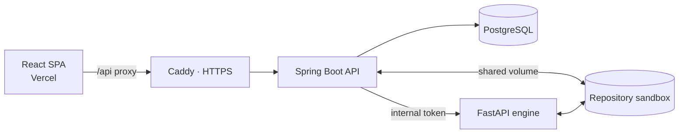

<h1 align="center">🛡️ SegSoft · Backend API</h1>

<p align="center">
  Spring Boot service that orchestrates <b>security-policy compliance analysis</b> of source code repositories.
</p>

<p align="center">
  
  
  
  
  
  <a href="https://www.segsoft.website/login"></a>
</p>

---

## Overview

SegSoft is an undergraduate capstone project at Icesi University. Users upload a repository (ZIP or Git URL), select the security policies to evaluate, and get findings across five categories: **SQL Injection, XSS, Authentication Failure, Insecure Data Handling and Dependency Vulnerability**. Policies are traceable to **ISO/IEC 27002** and **NIST** controls.

This repository is the main REST API. It manages users, repositories, policies and analyses, delegates rule execution to the [Python analysis engine](https://github.com/JEGH18/segsoft-motorpython), and produces the reports consumed by the [web app](https://github.com/JEGH18/segsoft-frontend).

## Features

| Area | What it does |
|---|---|
| **Auth** | Registration, login, refresh and logout with RS256-signed JWT; personal API tokens; rate limiting with Bucket4j |
| **Repositories** | ZIP upload or Git import into an isolated sandbox, with limits on size, file count, compression ratio (zip-bomb protection) and allowed Git domains |
| **Policies** | Policy and rule catalog with audit log, soft delete/restore and coverage view |
| **PolicySets** | Reusable groups of policies that can be applied to a repository in one step |
| **Frameworks** | ISO/IEC 27002 and NIST control catalogs linked to policies for traceability |
| **Analyses** | Runs every selected rule through the engine, with per-rule timeouts, and stores findings |
| **Reports** | Structured reports exported as **PDF** (OpenPDF) and **SARIF**, with an export cache |
| **Operations** | OpenAPI / Swagger UI, Actuator + Prometheus metrics, JSON logs (Logstash encoder) |

## API at a glance

```
/api/v1/auth                    register · login · refresh · logout · me · api-tokens
/api/v1/repositories            upload (multipart) · import (git) · files · policy-selection
/api/v1/policies                CRUD · coverage · traceability · audit-log
/api/v1/policy-sets             CRUD · audit-log · restore
/api/v1/frameworks              iso-27002 and nist controls
/api/v1/analyses                run · results · findings · reports
/api/v1/reports                 list · detail · export (PDF / SARIF)
```

Full, interactive documentation is available at `/swagger-ui.html` when the service is running.

## Architecture



In production, the backend, engine and PostgreSQL run with Docker Compose behind Caddy on an Azure VM; the frontend is served by Vercel. See [`deploy/README.md`](deploy/README.md).

## Run locally

Requirements: Java 17, Maven 3.9 and a PostgreSQL instance on `localhost:5432`.

```bash
./mvnw spring-boot:run -Dspring-boot.run.profiles=dev
# API:     http://localhost:8080
# Swagger: http://localhost:8080/swagger-ui.html
```

To start the whole stack (API, engine, database and Grafana), use Docker Compose as described in [segsoft-docs](https://github.com/JEGH18/segsoft-docs).

## Tests

```bash
mvn test
```

Integration tests use Testcontainers / PostgreSQL. CI runs on Jenkins (`Jenkinsfile`) and GitHub Actions.

## Related repositories

| Repository | Description |
|---|---|
| [segsoft-frontend](https://github.com/JEGH18/segsoft-frontend) | React 18 + Vite + TypeScript web app |
| [segsoft-motorpython](https://github.com/JEGH18/segsoft-motorpython) | FastAPI rule-execution engine |
| [segsoft-docs](https://github.com/JEGH18/segsoft-docs) | Technical documentation (in Spanish) |
| [SegSoft-Pruebas](https://github.com/JEGH18/SegSoft-Pruebas) | Benchmark projects for end-to-end validation |

> The official repositories live on Icesi University's p2tools Bitbucket; GitHub hosts a mirror.
